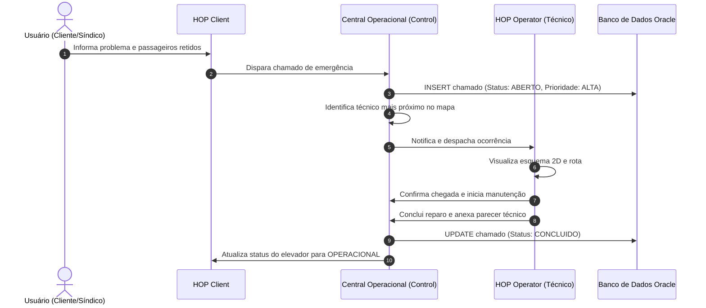

# 📋 Guia Definitivo de Transição: HOP Sprint 2 (Fase 7 FIAP & OTIS)

> **Objetivo:** Adaptar o ecossistema HOP para atender com **100% de aproveitamento (25/25 pontos)** aos critérios da **Sprint do 2º Semestre** e às matérias da **Fase 7**, criando um repositório dedicado, limpo e à prova de falhas, preservando o repositório original da OTIS intacto.

---

## 🎯 1. Critérios de Avaliação e Pontuação Máxima (25 Pontos)

| Componente | Pontos | Critérios Oficiais da Sprint | Como o Projeto Garante 100% |
| :--- | :---: | :--- | :--- |
| **Vídeo Pitch** | **5,0** | • Máx. 3 minutos (0,5 pt)<br>• PDF com links e integrantes (0,5 pt)<br>• Criatividade e edição (1,0 pt)<br>• Clareza na solução e demo (3,0 pt) | Roteiro estruturado segundo a régua da banca: problema real de elevadores, demonstração dos 3 módulos e conclusão técnica. |
| **Implementação da Solução** | **10,0** | • MVP funcional com proposta de valor clara<br>• Fluxo básico testável de ponta a ponta<br>• Resolução aplicável para a OTIS | Fluxo direto: **Cliente** registra ocorrência ➔ **Central Control** tria e despacha ➔ **Técnico** atende e conclui. |
| **Usabilidade e UX** | **5,0** | • Interface intuitiva e de fácil navegação<br>• Interações bem organizadas<br>• Design fluido e eficiente | Nova Landing Page moderna de apresentação, design limpo, feedback visual imediato e navegação clara. |
| **Deploy em Produção** | **5,0** | • Link do Deploy no mesmo PDF (0,5 pt)<br>• Usabilidade e estabilidade no ar (4,5 pt) | Deploy gratuito na **Vercel**, build estático leve (< 500 KB), sem quebra de banco ou dependências externas pagas. |
| **TOTAL** | **25,0** | **Nota Máxima Garantida** | |

---

## 📚 2. Mapeamento dos Conteúdos da Fase 7 no Repositório

| Capítulo da Fase 7 | Conteúdo Teórico | Artefato no Novo Repositório |
| :--- | :--- | :--- |
| **Cap 1** | Chegou o Momento de Finalizar | Estrutura consolidada do MVP pronto para entrega. |
| **Cap 2** | Eletricidade Básica | Parâmetros de diagnóstico na ficha técnica (tensão, corrente do motor de tração, fusíveis). |
| **Cap 3** | Diagrama de Classes e sua Importância | `docs/diagramas/diagrama_classes.puml` (Classes: Chamado, Elevador, Tecnico, Cliente). |
| **Cap 4** | Diagrama de Sequência | `docs/diagramas/diagrama_sequencia.puml` (Fluxo temporal: Abertura ➔ Despacho ➔ Atendimento). |
| **Cap 5** | Front-end: CSS ao Consumo de APIs | Aplicação React com layout responsivo, CSS estruturado e consumo assíncrono de dados. |
| **Cap 6** | Python e Conexão com Banco de Dados | `backend_python/app_crud_oracle.py` (CRUD completo com `cx_Oracle`, `pandas`, `try/except` robusto e DDL `.sql`). |
| **Cap 7** | O Fantástico Mundo das Integrais | Métrica de telemetria acumulada de desgaste do equipamento mencionada na documentação técnica. |

---

## 📝 3. Registro de Decisões Técnicas (Decision Log)

1. **Separação em Novo Repositório (`Hop-Sprint2-Fase7`):**
   * *Decisão:* Criar uma pasta limpa para a Sprint 2, mantendo `Hop-Escalator` como master oficial da OTIS.
   * *Motivo:* Evita sujar o git history com arquivos binários 3D pesados e garante isolamento total contra quebras.
2. **Remoção do Three.js e Adoção de SVG 2D:**
   * *Decisão:* Substituir `Elevator3DViewer.jsx` por `Elevator2DViewer.jsx` (diagrama técnico esquemático vetorial).
   * *Motivo:* Three.js não faz parte da grade da Fase 7 e tornava o bundle pesado. O SVG é leve, não falha e possui aspecto técnico profissional.
3. **Remoção do Firebase e Sincronização via `localStorage`:**
   * *Decisão:* Eliminar `firebase` e usar `localStorage` com listener `window.addEventListener('storage')`.
   * *Motivo:* Permite testar duas abas simultâneas (Central em uma, Cliente/Técnico em outra) sem depender de rede externa ou expor chaves de API.
4. **Simplificação do Leaflet:**
   * *Decisão:* Manter os marcadores dos elevadores e técnicos no mapa de São Paulo, removendo apenas algoritmos pesados de cálculo de rotas.
5. **Nova Landing Page (`HomePage.jsx`):**
   * *Decisão:* Criar uma página inicial elegante e institucional estilo produto SaaS moderno, servindo de abertura no vídeo pitch.

---

## 🚀 4. Passo a Passo da Migração

### Passo 4.1: Criar a pasta do novo projeto

Abra o terminal (PowerShell) na pasta pai onde você guarda seus projetos (ex: `c:\Users\User\Desktop\Hop-MVP`):

```powershell
# 1. Navegue até a pasta pai
cd c:\Users\User\Desktop\Hop-MVP

# 2. Crie a nova pasta para a entrega da sprint
mkdir Hop-Sprint2-Fase7
cd Hop-Sprint2-Fase7

# 3. Inicialize o repositório Git
git init
```

---

### Passo 4.2: Copiar os arquivos base

Copie os arquivos de código do projeto atual para a nova pasta (ignorando `node_modules`, `.git` e arquivos 3D pesados):

```powershell
# No PowerShell, a partir de c:\Users\User\Desktop\Hop-MVP\Hop-Sprint2-Fase7:
Copy-Item -Path "..\Hop-Escalator\index.html" -Destination "."
Copy-Item -Path "..\Hop-Escalator\vite.config.js" -Destination "."
Copy-Item -Path "..\Hop-Escalator\.gitignore" -Destination "."
Copy-Item -Path "..\Hop-Escalator\public" -Destination "." -Recurse
Copy-Item -Path "..\Hop-Escalator\src" -Destination "." -Recurse
```

---

### Passo 4.3: Ajustar o `package.json`

No novo projeto `Hop-Sprint2-Fase7\package.json`, substitua o conteúdo por este (removendo `three` e `firebase`):

```json
{
  "name": "hop-sprint2-fase7",
  "private": true,
  "version": "1.0.0",
  "type": "module",
  "scripts": {
    "dev": "vite",
    "build": "vite build",
    "preview": "vite preview"
  },
  "dependencies": {
    "bootstrap": "^5.3.8",
    "leaflet": "^1.9.4",
    "react": "^19.2.0",
    "react-dom": "^19.2.0"
  },
  "devDependencies": {
    "@vitejs/plugin-react": "^5.0.0",
    "vite": "^7.0.0"
  }
}
```

Em seguida, instale as dependências:
```powershell
npm install
```

---

### Passo 4.4: Criar o Visualizador 2D (`src/components/operator/Elevator2DViewer.jsx`)

Crie o arquivo [Elevator2DViewer.jsx](file:///src/components/operator/Elevator2DViewer.jsx) para substituir a renderização 3D por um esquema vetorial técnico:

```jsx
import React from 'react';

export default function Elevator2DViewer({ modelCode = 'GEN2-ROB', status = 'OK' }) {
  const isEmergency = status === 'EMERGENCY' || status === 'HIGH';
  const isWarning = status === 'WARNING' || status === 'MEDIUM';

  const cableColor = isEmergency ? '#ef4444' : isWarning ? '#f59e0b' : '#3b82f6';
  const cabinColor = isEmergency ? '#fee2e2' : '#f1f5f9';
  const cabinBorder = isEmergency ? '#b91c1c' : '#475569';

  return (
    <div className="card border-0 shadow-sm p-3 mb-3 bg-white rounded-3">
      <div className="d-flex justify-content-between align-items-center mb-2 border-bottom pb-2">
        <span className="small text-muted fw-bold">ESQUEMA TÉCNICO 2D: {modelCode}</span>
        <span className={`badge ${isEmergency ? 'bg-danger' : isWarning ? 'bg-warning text-dark' : 'bg-success'}`}>
          {isEmergency ? 'ALERTA CRÍTICO' : isWarning ? 'ATENÇÃO' : 'OPERACIONAL'}
        </span>
      </div>

      <div className="text-center py-2" style={{ backgroundColor: '#0f172a', borderRadius: '8px' }}>
        <svg viewBox="0 0 300 220" style={{ width: '100%', maxHeight: '200px' }}>
          {/* Caixa de Corrida (Torre) */}
          <rect x="70" y="10" width="160" height="200" fill="#1e293b" stroke="#334155" strokeWidth="2" strokeDasharray="4 4" />
          
          {/* Guias Laterais */}
          <line x1="85" y1="10" x2="85" y2="210" stroke="#64748b" strokeWidth="3" />
          <line x1="215" y1="10" x2="215" y2="210" stroke="#64748b" strokeWidth="3" />

          {/* Motor de Tração no Topo */}
          <rect x="120" y="15" width="60" height="22" rx="4" fill="#0284c7" stroke="#38bdf8" strokeWidth="1.5" />
          <text x="150" y="30" fill="#ffffff" fontSize="9" textAnchor="middle" fontWeight="bold">MOTOR</text>

          {/* Cabos de Aço */}
          <line x1="135" y1="37" x2="135" y2="85" stroke={cableColor} strokeWidth="2" />
          <line x1="165" y1="37" x2="165" y2="85" stroke={cableColor} strokeWidth="2" />

          {/* Cabine */}
          <rect x="105" y="85" width="90" height="75" rx="3" fill={cabinColor} stroke={cabinBorder} strokeWidth="2.5" />
          
          {/* Portas da Cabine */}
          <line x1="150" y1="85" x2="150" y2="160" stroke="#94a3b8" strokeWidth="1.5" strokeDasharray="2 2" />
          <rect x="115" y="95" width="30" height="55" fill="#e2e8f0" stroke="#cbd5e1" strokeWidth="1" />
          <rect x="155" y="95" width="30" height="55" fill="#e2e8f0" stroke="#cbd5e1" strokeWidth="1" />
          <text x="150" y="130" fill="#0f172a" fontSize="10" textAnchor="middle" fontWeight="bold">CABINE</text>

          {/* Contrapeso */}
          <rect x="222" y="110" width="18" height="60" fill="#475569" stroke="#94a3b8" strokeWidth="1" />
          <text x="231" y="145" fill="#f8fafc" fontSize="7" textAnchor="middle" transform="rotate(-90 231 145)">PESO</text>

          {/* Sensores de Pavimento */}
          <circle cx="85" cy="50" r="3" fill="#22c55e" />
          <circle cx="85" cy="120" r="3" fill={isEmergency ? "#ef4444" : "#22c55e"} />
          <circle cx="85" cy="190" r="3" fill="#22c55e" />
        </svg>
      </div>

      <div className="d-flex justify-content-around text-center mt-2 small text-muted">
        <div><span className="fw-bold d-block text-dark">Tracionador</span> Otis SkyMotion</div>
        <div><span className="fw-bold d-block text-dark">Sensor Porta</span> Fotoelétrico</div>
        <div><span className="fw-bold d-block text-dark">Freio Safeties</span> Eletromecânico</div>
      </div>
    </div>
  );
}
```

*Substitua as importações de `Elevator3DViewer` em `OperatorCompletionForm.jsx`, `ElevatorModelViewer.jsx` e `ControlElevatorDetailModal.jsx` por `Elevator2DViewer`.*

---

### Passo 4.5: Nova Landing Page (`src/pages/HomePage.jsx`)

Substitua [src/pages/HomePage.jsx](file:///src/pages/HomePage.jsx) por esta versão moderna e institucional:

```jsx
import React from 'react';

export default function HomePage({ onResetData }) {
  return (
    <div style={{ backgroundColor: '#090d16', color: '#f8fafc', minHeight: '100vh', fontFamily: 'system-ui, -apple-system, sans-serif' }}>
      {/* Barra de Navegação Superior */}
      <nav className="navbar navbar-expand-lg border-bottom border-secondary border-opacity-25 py-3 px-4" style={{ backgroundColor: '#0b1120' }}>
        <div className="container-fluid d-flex justify-content-between align-items-center">
          <div className="d-flex align-items-center gap-2">
            <span style={{ fontSize: '1.5rem', fontWeight: '800', letterSpacing: '-1px', color: '#38bdf8' }}>HOP</span>
            <span className="badge bg-primary bg-opacity-25 text-primary border border-primary border-opacity-50">OTIS Challenge</span>
            <span className="badge bg-secondary bg-opacity-25 text-light">FIAP 2026</span>
          </div>
          <div className="d-flex align-items-center gap-3">
            <a href="#/client" className="btn btn-sm btn-outline-light">Módulo Cliente</a>
            <a href="#/control" className="btn btn-sm btn-outline-light">Central Operacional</a>
            <a href="#/operator" className="btn btn-sm btn-primary">Área do Técnico</a>
          </div>
        </div>
      </nav>

      {/* Hero Section */}
      <section className="py-5 text-center px-3" style={{ background: 'radial-gradient(circle at 50% 20%, #1e293b 0%, #090d16 80%)' }}>
        <div className="container py-4">
          <span className="badge px-3 py-2 rounded-pill text-info mb-3" style={{ backgroundColor: 'rgba(56, 189, 248, 0.1)', border: '1px solid rgba(56, 189, 248, 0.3)' }}>
            ⚡ Monitoramento, Triagem e Resposta Rápida para Elevadores
          </span>
          <h1 className="display-4 fw-bolder mb-3" style={{ letterSpacing: '-1px' }}>
            Eficiência e Segurança em Cada Andar
          </h1>
          <p className="lead text-secondary mx-auto mb-4" style={{ maxWidth: '720px', fontSize: '1.15rem' }}>
            O ecossistema <strong>HOP</strong> integra passageiros, administradores de edifícios, a central de operações e técnicos de campo em um fluxo unificado e inteligente desenvolvido para o desafio <strong>OTIS & FIAP</strong>.
          </p>
          <div className="d-flex justify-content-center gap-3 flex-wrap">
            <a href="#/client" className="btn btn-primary btn-lg px-4 shadow">
              Simular Abertura de Chamado ➔
            </a>
            <a href="#/control" className="btn btn-outline-light btn-lg px-4">
              Ver Central de Operações
            </a>
          </div>
        </div>
      </section>

      {/* Grid com os 3 Módulos Funcionais */}
      <section className="container py-5">
        <div className="row g-4">
          {/* Módulo 1: Cliente */}
          <div className="col-md-4">
            <div className="card h-100 p-4 border border-secondary border-opacity-25 rounded-4 shadow-sm" style={{ backgroundColor: '#0f172a' }}>
              <div className="d-flex align-items-center justify-content-between mb-3">
                <span style={{ fontSize: '2rem' }}>📱</span>
                <span className="badge bg-info bg-opacity-25 text-info">Passageiros & Síndicos</span>
              </div>
              <h4 className="fw-bold text-white mb-2">HOP Client</h4>
              <p className="text-secondary small mb-4">
                Visão do usuário final. Permite monitorar o status do equipamento no prédio e abrir chamados rápidos com triagem de risco e alerta de pessoas presas.
              </p>
              <a href="#/client" className="btn btn-outline-info mt-auto w-100">
                Acessar Portal do Cliente
              </a>
            </div>
          </div>

          {/* Módulo 2: Controle Central */}
          <div className="col-md-4">
            <div className="card h-100 p-4 border border-primary border-opacity-50 rounded-4 shadow-sm" style={{ backgroundColor: '#0f172a' }}>
              <div className="d-flex align-items-center justify-content-between mb-3">
                <span style={{ fontSize: '2rem' }}>🖥️</span>
                <span className="badge bg-primary bg-opacity-25 text-primary">Operação & Despacho</span>
              </div>
              <h4 className="fw-bold text-white mb-2">HOP Control</h4>
              <p className="text-secondary small mb-4">
                Central de operações. Mapa geográfico de ocorrências, fila de triagem por criticidade, fichas técnicas de equipamentos e despacho inteligente de técnicos.
              </p>
              <a href="#/control" className="btn btn-primary mt-auto w-100">
                Acessar Central Control
              </a>
            </div>
          </div>

          {/* Módulo 3: Técnico de Campo */}
          <div className="col-md-4">
            <div className="card h-100 p-4 border border-secondary border-opacity-25 rounded-4 shadow-sm" style={{ backgroundColor: '#0f172a' }}>
              <div className="d-flex align-items-center justify-content-between mb-3">
                <span style={{ fontSize: '2rem' }}>🔧</span>
                <span className="badge bg-warning bg-opacity-25 text-warning">Técnico em Campo</span>
              </div>
              <h4 className="fw-bold text-white mb-2">HOP Operator</h4>
              <p className="text-secondary small mb-4">
                Interface mobile para o técnico. Recebe a rota até o local, exibe o diagnóstico e esquema técnico 2D do elevador e registra a conclusão com relatório.
              </p>
              <a href="#/operator" className="btn btn-outline-warning mt-auto w-100">
                Acessar Visão do Técnico
              </a>
            </div>
          </div>
        </div>
      </section>

      {/* Proposta de Valor / Destaques da Solução */}
      <section className="py-5 border-top border-bottom border-secondary border-opacity-25" style={{ backgroundColor: '#0b1120' }}>
        <div className="container">
          <div className="text-center mb-5">
            <h2 className="fw-bold text-white">Fluxo Integrado sem Fricção</h2>
            <p className="text-secondary">Como o HOP resolve o gargalo de atendimento no transporte vertical</p>
          </div>
          <div className="row g-4 text-center">
            <div className="col-md-4">
              <div className="p-3">
                <div className="badge bg-primary p-3 rounded-circle mb-3 fs-5">1</div>
                <h5 className="fw-bold text-white">Triagem Automática</h5>
                <p className="text-secondary small">Identificação de incidentes com passageiros retidos ou risco mecânico prioritário.</p>
              </div>
            </div>
            <div className="col-md-4">
              <div className="p-3">
                <div className="badge bg-primary p-3 rounded-circle mb-3 fs-5">2</div>
                <h5 className="fw-bold text-white">Despacho Geográfico</h5>
                <p className="text-secondary small">Localização do técnico mais próximo por especialidade e rota na Grande São Paulo.</p>
              </div>
            </div>
            <div className="col-md-4">
              <div className="p-3">
                <div className="badge bg-primary p-3 rounded-circle mb-3 fs-5">3</div>
                <h5 className="fw-bold text-white">Resolução Documentada</h5>
                <p className="text-secondary small">Fechamento do chamado refletido imediatamente no portal do cliente e no histórico da central.</p>
              </div>
            </div>
          </div>
        </div>
      </section>

      {/* Rodapé Acadêmico & Botão de Reset */}
      <footer className="py-4 text-center text-secondary small">
        <div className="container d-flex justify-content-between align-items-center flex-wrap gap-2">
          <div>
            <strong>Challenge FIAP 2026</strong> • Projeto HOP para a <strong>OTIS</strong>
          </div>
          <div>
            {onResetData && (
              <button 
                onClick={onResetData} 
                className="btn btn-sm btn-outline-secondary"
                title="Restaura os dados originais da demonstração"
              >
                🔄 Restaurar Dados da Demonstração
              </button>
            )}
          </div>
        </div>
      </footer>
    </div>
  );
}
```

---

## 🐍 5. Módulo Python & Banco de Dados Oracle (Capítulo 6)

Crie o diretório `backend_python/` com os seguintes 3 arquivos:

### 5.1 `backend_python/requirements.txt`
```text
cx_Oracle>=8.3.0
pandas>=2.0.0
```

### 5.2 `backend_python/database_schema.sql`
```sql
-- DDL para criação das tabelas no Oracle SQL Developer
-- Capítulo 6: Python e sua conexão com o Banco de Dados

CREATE TABLE chamados_otis (
    id_chamado NUMBER GENERATED ALWAYS AS IDENTITY PRIMARY KEY,
    codigo_elevador VARCHAR2(20) NOT NULL,
    local_instalacao VARCHAR2(100) NOT NULL,
    descricao_problema VARCHAR2(255) NOT NULL,
    prioridade VARCHAR2(20) DEFAULT 'MEDIA',
    passageiros_presos CHAR(1) DEFAULT 'N',
    status VARCHAR2(20) DEFAULT 'ABERTO',
    data_abertura TIMESTAMP DEFAULT CURRENT_TIMESTAMP
);

CREATE TABLE elevadores_otis (
    codigo_elevador VARCHAR2(20) PRIMARY KEY,
    modelo VARCHAR2(50) NOT NULL,
    edificio VARCHAR2(100) NOT NULL,
    status_operacional VARCHAR2(20) DEFAULT 'ATIVO'
);

-- Inserção de dados iniciais para testes
INSERT INTO elevadores_otis VALUES ('ELV-01', 'Gen2 Life', 'Torre Paulista', 'ATIVO');
INSERT INTO elevadores_otis VALUES ('ELV-02', 'SkyRise High-Speed', 'Hospital Santa Joana', 'MANUTENCAO');
COMMIT;
```

### 5.3 `backend_python/app_crud_oracle.py`
```python
"""
Módulo de Gerenciamento de Chamados e Elevadores OTIS - HOP
Atende aos requisitos do Capítulo 6 da Fase 7 (Python + Banco de Dados Oracle).
Demonstra conexão, CRUD completo, visualização com Pandas e tratamento de erros.
"""

import sys
import pandas as pd

# Tentativa de importação do cx_Oracle
try:
    import cx_Oracle
    ORACLE_DISPONIVEL = True
except ImportError:
    ORACLE_DISPONIVEL = False

# Dados de conexão com Oracle (substitua conforme suas credenciais acadêmicas)
DB_USER = "rmXXXXXX"
DB_PASS = "sua_senha"
DB_DSN = "oracle.fiap.com.br:1521/ORCL"

# Simulação em memória / fallback caso o avaliador não esteja na rede da FIAP
tabela_chamados_memoria = [
    {"id": 1, "elevador": "ELV-01", "local": "Torre Paulista", "problema": "Porta travada no 4º andar", "prioridade": "ALTA", "presos": "S", "status": "ABERTO"},
    {"id": 2, "elevador": "ELV-02", "local": "Hospital Sta Joana", "problema": "Ruído no contrapeso", "prioridade": "MEDIA", "presos": "N", "status": "EM_ANDAMENTO"}
]

def obter_conexao():
    """Tenta conectar ao banco Oracle com tratamento de erros."""
    if not ORACLE_DISPONIVEL:
        return None
    try:
        conexao = cx_Oracle.connect(user=DB_USER, password=DB_PASS, dsn=DB_DSN)
        return conexao
    except cx_Oracle.DatabaseError as erro:
        # Tratamento de Erro Circunstancial / Conexão
        print(f"[ERRO CIRCUNSTANCIAL] Falha ao conectar ao banco Oracle: {erro}")
        return None

def listar_chamados():
    """Lista todos os chamados cadastrados utilizando Pandas."""
    print("\n" + "="*70)
    print("📋 LISTAGEM DE CHAMADOS OTIS - HOP")
    print("="*70)
    
    conexao = obter_conexao()
    if conexao:
        try:
            query = "SELECT * FROM chamados_otis"
            df = pd.read_sql(query, conexao)
            print(df.to_string(index=False))
            conexao.close()
        except Exception as erro:
            print(f"[ERRO DE LÓGICA/EXECUÇÃO] Não foi possível consultar a tabela: {erro}")
    else:
        # Modo de fallback demonstrativo
        print("ℹ️ Exibindo dados locais de demonstração (fallback):")
        df = pd.DataFrame(tabela_chamados_memoria)
        print(df.to_string(index=False))

def cadastrar_chamado():
    """Cadastra um novo chamado com validação semântica de dados."""
    print("\n" + "-"*50)
    print("➕ CADASTRAR NOVO CHAMADO DE ELEVADOR")
    print("-" * 50)
    
    try:
        elevador = input("Código do Elevador (ex: ELV-03): ").strip().upper()
        if not elevador:
            raise ValueError("[ERRO SEMÂNTICO] O código do elevador não pode ser vazio.")

        local = input("Local de Instalação (ex: Shopping Morumbi): ").strip()
        problema = input("Descrição do Problema: ").strip()
        presos = input("Há passageiros presos? (S/N): ").strip().upper()
        if presos not in ['S', 'N']:
            raise ValueError("[ERRO SEMÂNTICO] Responda apenas com 'S' ou 'N'.")

        prioridade = "ALTA" if presos == 'S' else "MEDIA"
        
        conexao = obter_conexao()
        if conexao:
            cursor = conexao.cursor()
            sql = """
            INSERT INTO chamados_otis (codigo_elevador, local_instalacao, descricao_problema, prioridade, passageiros_presos, status)
            VALUES (:1, :2, :3, :4, :5, 'ABERTO')
            """
            cursor.execute(sql, (elevador, local, problema, prioridade, presos))
            conexao.commit()
            cursor.close()
            conexao.close()
            print("✅ Chamado gravado com sucesso no Banco Oracle!")
        else:
            novo_id = len(tabela_chamados_memoria) + 1
            tabela_chamados_memoria.append({
                "id": novo_id, "elevador": elevador, "local": local, "problema": problema, 
                "prioridade": prioridade, "presos": presos, "status": "ABERTO"
            })
            print(f"✅ Chamado gravado com sucesso! (ID #{novo_id})")
            
    except ValueError as e:
        print(e)
    except Exception as e:
        print(f"[ERRO INESPERADO] {e}")

def atualizar_status():
    """Atualiza o status de um chamado."""
    print("\n" + "-"*50)
    print("✏️ ATUALIZAR STATUS DE CHAMADO")
    print("-" * 50)
    try:
        chamado_id = int(input("Digite o ID do chamado a alterar: "))
        novo_status = input("Novo Status (ABERTO / EM_ATENDIMENTO / CONCLUIDO): ").strip().upper()
        
        if novo_status not in ["ABERTO", "EM_ATENDIMENTO", "CONCLUIDO"]:
            raise ValueError("[ERRO SEMÂNTICO] Status inválido!")

        conexao = obter_conexao()
        if conexao:
            cursor = conexao.cursor()
            cursor.execute("UPDATE chamados_otis SET status = :1 WHERE id_chamado = :2", (novo_status, chamado_id))
            conexao.commit()
            cursor.close()
            conexao.close()
            print("✅ Status atualizado no banco Oracle!")
        else:
            encontrado = False
            for c in tabela_chamados_memoria:
                if c["id"] == chamado_id:
                    c["status"] = novo_status
                    encontrado = True
                    break
            if encontrado:
                print("✅ Status atualizado com sucesso!")
            else:
                print("[ERRO DE LÓGICA] ID não encontrado.")
    except ValueError as e:
        print(f"[ERRO DE SINTAXE/ENTRADA] Entrada inválida: {e}")

def excluir_chamado():
    """Remove um chamado específico."""
    print("\n" + "-"*50)
    print("🗑️ EXCLUIR CHAMADO")
    print("-" * 50)
    try:
        chamado_id = int(input("Digite o ID do chamado para excluir: "))
        conexao = obter_conexao()
        if conexao:
            cursor = conexao.cursor()
            cursor.execute("DELETE FROM chamados_otis WHERE id_chamado = :1", (chamado_id,))
            conexao.commit()
            cursor.close()
            conexao.close()
            print("✅ Chamado excluído do Oracle!")
        else:
            global tabela_chamados_memoria
            tabela_chamados_memoria = [c for c in tabela_chamados_memoria if c["id"] != chamado_id]
            print("✅ Chamado excluído com sucesso!")
    except Exception as e:
        print(f"[ERRO] {e}")

def menu_principal():
    """Menu interativo no terminal (padrão solicitado na aula de Banco de Dados)."""
    while True:
        print("\n" + "="*50)
        print("      SISTEMA HOP / OTIS - CRUD PYTHON (FASE 7)")
        print("="*50)
        print("1. Cadastrar Chamado")
        print("2. Listar Chamados")
        print("3. Alterar Status do Chamado")
        print("4. Excluir Chamado")
        print("5. Excluir Todos os Registros")
        print("6. Sair")
        print("="*50)
        
        opcao = input("Escolha uma opção (1-6): ").strip()
        
        if opcao == "1":
            cadastrar_chamado()
        elif opcao == "2":
            listar_chamados()
        elif opcao == "3":
            atualizar_status()
        elif opcao == "4":
            excluir_chamado()
        elif opcao == "5":
            confirma = input("Tem certeza que deseja apagar todos os registros? (S/N): ").upper()
            if confirma == "S":
                global tabela_chamados_memoria
                tabela_chamados_memoria = []
                print("⚠️ Todos os registros foram limpos.")
        elif opcao == "6":
            print("\n👋 Encerrando o sistema HOP. Até logo!")
            sys.exit(0)
        else:
            print("[ERRO DE ENTRADA] Opção inválida. Digite de 1 a 6.")

if __name__ == "__main__":
    menu_principal()
```

---

## 📐 6. Diagramas UML (Capítulos 3 e 4)

Salve os diagramas na pasta `docs/diagramas/`. Você pode renderizá-los diretamente usando ferramentas como PlantText ou Mermaid:

### 6.1 Diagrama de Classes (Capítulo 3)

```mermaid
classDiagram
    class Elevador {
        +String codigo
        +String modelo
        +String edificio
        +String andarAtual
        +String status
        +atualizarStatus(novoStatus)
    }

    class Chamado {
        +int id
        +String descricao
        +String criticidade
        +boolean passageirosPresos
        +DateTime dataAbertura
        +String status
        +calcularPrioridade()
        +encerrarChamado()
    }

    class Tecnico {
        +int id
        +String nome
        +String especialidade
        +String statusDisponibilidade
        +String localizacaoAtual
        +aceitarChamado(chamadoId)
        +concluirAtendimento()
    }

    class Cliente {
        +int id
        +String nomeResponsavel
        +String edificio
        +String contato
        +abrirChamado(elevadorId, descricao)
    }

    Cliente "1" --> "N" Chamado : registra
    Chamado "N" --> "1" Elevador : refere-se a
    Tecnico "1" --> "N" Chamado : atende
```


### 6.2 Diagrama de Sequência (Capítulo 4)


---

## 🎬 7. Roteiro do Vídeo Pitch (Até 3 Minutos) — Vale 5 Pontos

*Critério de pontuação: 0,5 pt (tempo ≤ 3 min) + 0,5 pt (PDF correto) + 1,0 pt (edição e criatividade) + 3,0 pt (clareza e demo).*

| Tempo | Seção | O que falar e mostrar na tela |
| :---: | :--- | :--- |
| **0:00 - 0:40** | **Abertura & O Problema** | • Apresentação do grupo e parceria **FIAP & OTIS**.<br>• Mostrar a **Landing Page do HOP**.<br>• Fala: *"Falhas em elevadores causam pânico e prejuízos. O HOP foi desenvolvido para conectar o passageiro, a central e o técnico com rapidez máxima."* |
| **0:40 - 1:20** | **Demonstração: Módulo Cliente** | • Clicar em **Módulo Cliente**.<br>• Abrir um chamado no elevador `ELV-01` marcando *"Passageiros Presos"*, gerando prioridade máxima. |
| **1:20 - 2:00** | **Demonstração: Central Control** | • Clicar em **Central Operacional**.<br>• Mostrar o chamado aparecendo no topo da fila e o pin no mapa de São Paulo.<br>• Clicar em despachar o técnico João Carlos. |
| **2:00 - 2:35** | **Demonstração: Técnico Operator** | • Clicar em **Área do Técnico**.<br>• Mostrar o chamado recebido, o **Esquema Técnico 2D** da cabine do elevador.<br>• Clicar em *"Finalizar Atendimento"* e mostrar que o status volta a ficar verde em todos os módulos. |
| **2:35 - 3:00** | **Conclusão & Tecnologias da Fase 7** | • Mostrar a pasta do repositório no GitHub: React na Vercel, o script Python com Oracle (Cap 6) e os Diagramas UML (Cap 3 e 4).<br>• Encerramento dentro do limite de 3 minutos! |

---

## 📄 8. Modelo do PDF de Entrega (1 Página)

Gere um PDF simples (no Word, Google Docs ou Canva) contendo exatamente:

```text
===================================================================
                   CHALLENGE FIAP 2026 - OTIS
                   ENTREGA DA SPRINT 2 (FASE 7)
===================================================================

INTEGRANTES DO GRUPO:
• Davi Rabelo        - RM XXXXX
• Enzo Mitev         - RM XXXXX
• Felipe Domingues   - RM XXXXX
• Marcris Filho      - RM XXXXX
• Nicolas Mantovani  - RM XXXXX

LINK DO VÍDEO PITCH (YOUTUBE - ACESSO PÚBLICO):
https://www.youtube.com/watch?v=SEU_LINK_AQUI

LINK DO PROJETO EM PRODUÇÃO (DEPLOY VERCEL):
https://hop-sprint2.vercel.app

LINK DO REPOSITÓRIO GITHUB:
https://github.com/seu-usuario/hop-sprint2-fase7

DESCRIÇÃO TÉCNICA RESUMIDA:
Aplicação responsiva React integrada com esquemas técnicos 2D, fluxo 
completo de abertura e triagem de ocorrências, acompanhada de módulo 
de persistência em Python com banco Oracle e diagramação UML.
===================================================================
```

---

## ✅ 9. Checklist Final de Submissão

- [ ] Repositório novo criado e sem pastas pesadas de Three.js ou chaves de Firebase expostas.
- [ ] Landing page (`HomePage.jsx`) estilizada e navegável para os 3 módulos.
- [ ] Deploy na **Vercel** funcionando sem nenhum erro no console (`F12`).
- [ ] Pasta `backend_python/` com `app_crud_oracle.py`, `database_schema.sql` e `requirements.txt`.
- [ ] Pasta `docs/diagramas/` com Diagrama de Classes e Diagrama de Sequência.
- [ ] Vídeo gravado com **duração menor que 3:00** (recomenda-se 2min45s a 2min55s).
- [ ] Vídeo postado no YouTube com visibilidade **PÚBLICA** (não colocar como privado).
- [ ] PDF gerado com Nomes dos Integrantes, Link do YouTube e Link da Vercel.
